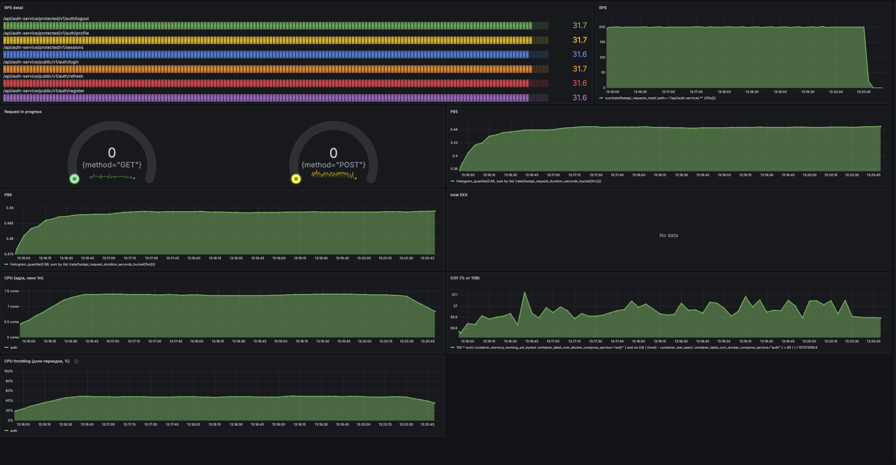

# AINexus

## Исследование производительности сервиса аутентификации

В ходе нагрузочного тестирования `auth` узкое место оказалось не в одном долгом INSERT. На время ответа влияли план SQL-запроса поиска пользователя, повторная обработка RSA-ключа и доступный процессу CPU. После оптимизации запросов и использования ключа, а затем увеличения CPU-лимита, пропускная способность выросла примерно с 70 до 140, а затем до 200 запросов в секунду.

Последний прогон удерживал около 200 RPS на плато. За полный запуск Locust зарегистрировал 58 080 запросов за 300 секунд — в среднем 193,6 RPS с учётом разгона и остановки. Среднее значение за все пять минут отличается от установившейся нагрузки на графике.

### Сводка результатов

| Этап | Ресурсы контейнера `auth` | Результат | Наблюдение |
| --- | --- | ---: | --- |
| До оптимизаций | 1 CPU, 1 ГБ RAM | около 70 RPS | Поиск пользователя выполнялся с `Seq Scan`; в трассах были долгие `connect` и SQL spans, CPU `auth` достигал лимита. |
| После оптимизаций | 1 CPU, 1 ГБ RAM | около 140 RPS | Индексируемый поиск по логину или email, повторное использование RSA-ключа и индексы для операций сессий снизили нагрузку на БД и приложение. Дальше ограничивал CPU сервиса. |
| После увеличения CPU | 2 CPU, 1 ГБ RAM | около 200 RPS | На финальном пятиминутном прогоне график показывает ровное плато около 200 RPS. CPU `auth` использовал примерно 1,4 ядра из 2; память оставалась около 37% от лимита. |

Числа для первых двух этапов — результаты предыдущих прогонов. Финальная таблица процентов ниже относится к прогону на 2 CPU и 1 ГБ RAM.

### Условия финального теста

Во всех сравниваемых запусках использовался один сценарий `register_login_user` и одинаковые параметры нагрузки:

| Параметр | Значение |
| --- | ---: |
| Виртуальные пользователи | 100 |
| Скорость запуска пользователей | 5 в секунду |
| Время прогона | 300 секунд |
| Режим | headless |
| Частота выполнения задач одним пользователем | 2 в секунду (`constant_throughput(2)`) |
| CPU `auth` в финальном прогоне | 2 CPU |
| Память `auth` в финальном прогоне | 1 ГБ |

Конфигурация Locust находится в [`v1.0.conf`](services/auth/tests/perfomance/scenarios/register_login_user/v1.0.conf), а частота задач задаётся в [`user.py`](services/auth/tests/perfomance/tools/locust/user.py). Последовательность каждого пользователя состоит из регистрации, входа, обновления токена, чтения профиля, чтения списка сессий и выхода. При 100 пользователях и целевых двух запросах на пользователя в секунду теоретический темп составляет около 200 RPS; фактический темп подтверждается метрикой и итоговым отчётом Locust.

### Что показал разбор

**Поиск пользователя не использовал ожидаемые индексы.** Первоначальный запрос соединял `users` и `users_cred`, а затем применял `OR` к `username` и `email`. Проверка плана выполнения показала параллельные `Seq Scan` обеих таблиц, `Hash Join` и фильтрацию после соединения. Уникальные индексы на отдельных колонках не означали, что этот конкретный запрос будет по ним искать.

Поиск разделили на две независимые ветки через `UNION ALL`: одна ищет по username, другая по email. Такой запрос позволяет планировщику использовать соответствующий индекс для каждого критерия. Дополнительно добавили индексы для обращений к сессиям. В результате БД обрабатывает меньше строк и снижает давление на кэш страниц.

**RSA-ключ разбирался на каждом выпуске токена.** `JWTCoder` уже создавался один раз на время жизни DI-контейнера, но хранил PEM как строку. При каждом `jwt.encode()` PyJWT заново загружал строку и формировал объект RSA-ключа. Теперь PEM разбирается при создании `JWTCoder`, а приложение повторно использует объект ключа. Это убирает повторную криптографическую инициализацию из каждого запроса.

**После этих изменений ограничением оставался CPU `auth`.** На одном CPU процесс упирался в установленный лимит и часто подвергался throttling. При повышении лимита `auth` до 2 CPU пропускная способность выросла примерно со 140 до 200 RPS. CPU и память PostgreSQL имеют отдельные лимиты и не менялись вместе с CPU сервиса в этом сравнении.

Во время настройки PostgreSQL также увеличили `shm_size` с 256 до 512 МБ. Это изменение согласуется с наблюдением нехватки shared memory при прежнем плане запроса, но имеющиеся результаты не позволяют измерить его отдельный вклад в прирост RPS. Одновременно изменялись план SQL и обработка JWT; числа по этапам показывают совокупный результат изменений.

### Результаты Locust на 2 CPU и 1 ГБ RAM

Время ответа указано в миллисекундах. Процентили Locust являются приближёнными. Строка `Aggregated` объединяет запросы всех маршрутов.

| Метод | Маршрут | p50 | p66 | p75 | p80 | p90 | p95 | p98 | p99 | p99.9 | p99.99 | Макс. | Запросов |
| --- | --- | ---: | ---: | ---: | ---: | ---: | ---: | ---: | ---: | ---: | ---: | ---: | ---: |
| POST | `/api/auth-service/protected/v1/auth/logout` | 170 | 190 | 240 | 250 | 260 | 270 | 290 | 340 | 360 | 370 | 370 | 9 650 |
| GET | `/api/auth-service/protected/v1/auth/profile` | 130 | 160 | 170 | 170 | 190 | 240 | 260 | 270 | 280 | 350 | 350 | 9 685 |
| GET | `/api/auth-service/protected/v1/sessions` | 200 | 260 | 270 | 280 | 310 | 320 | 340 | 340 | 370 | 390 | 390 | 9 650 |
| POST | `/api/auth-service/public/v1/auth/login` | 270 | 280 | 290 | 290 | 350 | 360 | 370 | 370 | 460 | 470 | 470 | 9 695 |
| POST | `/api/auth-service/public/v1/auth/refresh` | 330 | 340 | 350 | 350 | 360 | 370 | 380 | 390 | 410 | 440 | 440 | 9 685 |
| POST | `/api/auth-service/public/v1/auth/register` | 310 | 330 | 340 | 350 | 360 | 370 | 380 | 390 | 430 | 450 | 450 | 9 715 |
| **Aggregated** | — | **260** | **290** | **310** | **320** | **340** | **360** | **370** | **380** | **410** | **470** | **470** | **58 080** |

Суммарные p95 и p99 составляют 360 мс и 380 мс. Самые высокие p95 в этом запуске — у `register` и `refresh` (по 370 мс); их максимальные значения — 450 мс и 440 мс соответственно.

### Графики финального прогона

Во время устойчивой части прогона общий RPS держался около 200. P95 на графике — около 0,44 секунды, P99 — около 0,49 секунды. Потребление CPU `auth` находилось примерно на уровне 1,4 ядра, а throttling — около 45–50% периодов. После окончания нагрузки RPS и потребление CPU снижаются. Ошибок 5xx на панели нет данных; это означает отсутствие собранной серии для отображения, а не отдельное измерение успешности каждого запроса.

### Вывод

Рост пропускной способности сложился из трёх изменений: устранения `Seq Scan` в поиске по логину и email, добавления индексов для операций сессий и повторного использования разобранного RSA-ключа. После этого сервис на 1 CPU достигал примерно 140 RPS и упирался в CPU. Увеличение лимита до 2 CPU позволило удерживать около 200 RPS при 100 пользователях и неизменных параметрах сценария.

Материалы по подготовке тестовых данных и запуску Locust описаны в [`README.md` инструментария производительности](services/auth/tests/perfomance/README.md).
